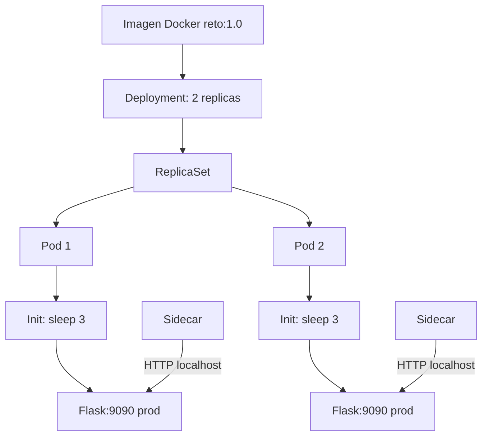

# Del Dockerfile al Pod

Práctica académica de computación en la nube — Ingeniería en Sistemas Computacionales, UJAT.

## Objetivo
Construir imágenes Docker, desplegar microservicios Flask en Kubernetes y comprobar configuración, diagnóstico, inicialización, monitoreo y autorrecuperación.

## Requisitos
Windows CMD, Docker Desktop con Kubernetes habilitado, Git, kubectl y acceso a Internet para descargar las imágenes base. Entorno observado: Docker 29.9.2, Kubernetes 1.36.1, Git 2.55.0.windows.5, Flask 3.0.3.

## Estructura
- `ej1/`: capas, caché y aislamiento.
- `thoughts-api/`: microservicio y manifiestos de los ejercicios 2–10.
- `reto-final/`: práctica integradora.
- `documentacion/`: resultados, incidencias, comandos y guion.

## Ejecutar el reto final
Desde la raíz del repositorio, en CMD:
```cmd
kubectl get nodes
kubectl create namespace example --dry-run=client -o yaml | kubectl apply -f -
cd reto-final
docker build -t miusuario/reto:1.0 .
docker run -d -p 9090:9090 --name reto-prueba miusuario/reto:1.0
curl http://127.0.0.1:9090/
docker rm -f reto-prueba
kubectl apply -f deployment.yaml --dry-run=client
kubectl apply -f deployment.yaml
kubectl rollout status deployment/reto-integrador -n example
kubectl get pods -n example -l app=reto-integrador
kubectl logs -n example -l app=reto-integrador -c preparacion --prefix=true
kubectl logs -n example -l app=reto-integrador -c monitor --prefix=true --tail=10
```
En otra ventana ejecutar `kubectl port-forward deployment/reto-integrador 9090:9090 -n example`; desde la primera, consultar `curl http://127.0.0.1:9090/`. Detener el túnel con Ctrl+C.

## Arquitectura

La imagen usa ENTORNO=dev; Kubernetes lo sobrescribe con prod. Cada Pod contiene un Init Container temporal y dos contenedores permanentes. La readinessProbe consulta HTTP cada cinco segundos; el Sidecar espera diez segundos entre consultas. El ReplicaSet recrea Pods eliminados.

## Ejercicios y documentación
- [Resultados por ejercicio](documentacion/resultados.md)
- [Registro de incidencias](documentacion/registro-incidencias.md)
- [Comandos de reproducción](documentacion/comandos.md)
- [Guion del video](documentacion/guion-video.md)

## Consideraciones
Las imágenes de la aplicación son locales y usan imagePullPolicy Never. El clúster debe tener acceso a ellas; en otros clústeres puede ser necesario importarlas. Los manifiestos de error son deliberadamente defectuosos: no aplicar todos los YAML en conjunto. El ejercicio 9B utiliza ahora cmd-error en vez de v2, para conservar la versión funcional v2. Flask usa su servidor de desarrollo; ENTORNO=prod no implica preparación real para producción. Port-forward no demuestra balanceo ni disponibilidad continua. No se probó tolerancia a fallos de nodo.

## Referencias oficiales de consulta
- Docker: https://docs.docker.com/
- Kubernetes (español): https://kubernetes.io/es/docs/home/
- Flask: https://flask.palletsprojects.com/
- Git: https://git-scm.com/doc
- GitHub (español): https://docs.github.com/es

## Conclusión
La práctica permitió comprender la transición de una imagen Docker a una aplicación orquestada, la separación entre imagen y configuración, y el diagnóstico y recuperación de contenedores mediante Kubernetes.
